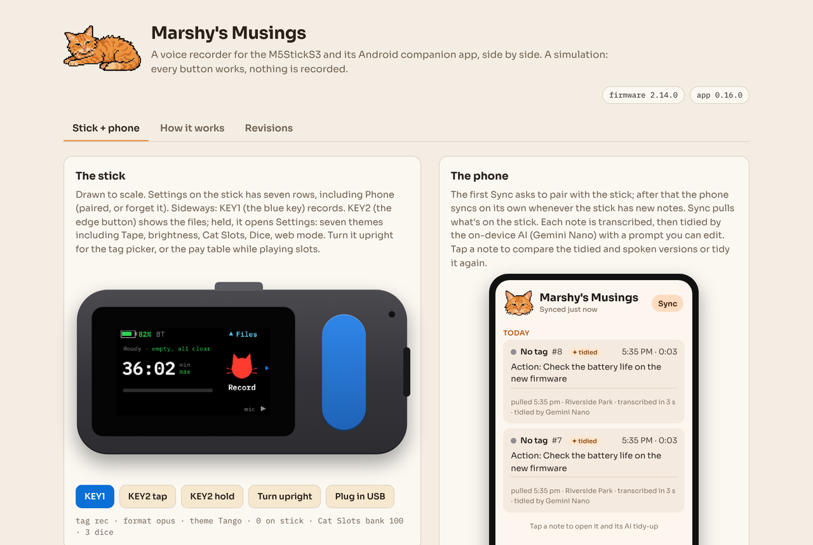

## Try it in your browser

**[Open the simulation →](https://meerdog.github.io/MarshyMusings/)**

A working model of app 0.16.0 next to the M5StickS3 running firmware 2.14.0. Record on the stick, tap Sync to pair and pull the notes, then open one to compare the AI-tidied text with what was spoken. The tidy-up prompt is editable in Settings, as in the app. Nothing is recorded; the notes are examples, and transcription and Gemini Nano are stand-ins here.

The firmware lives at [Meerdog/M5MarshyMusings](https://github.com/Meerdog/M5MarshyMusings).
